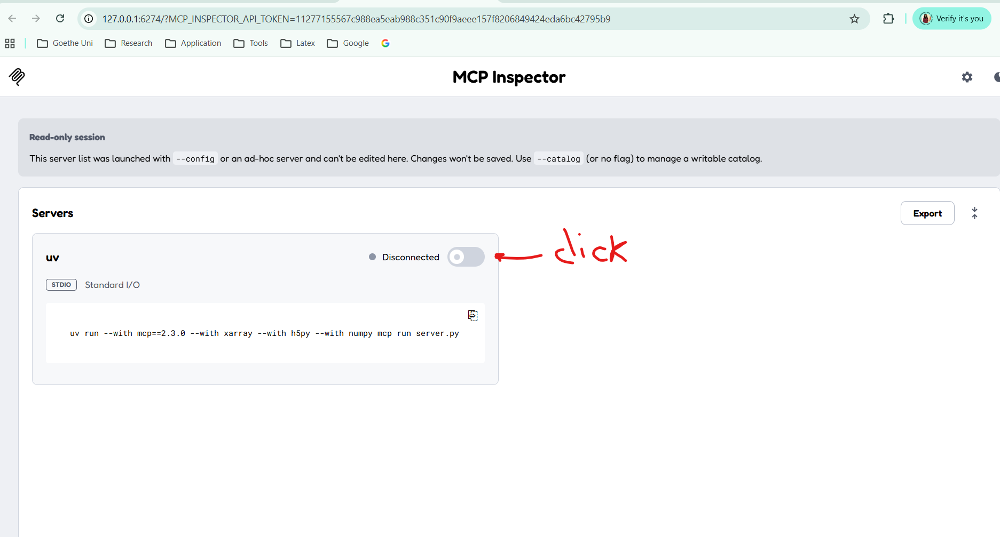
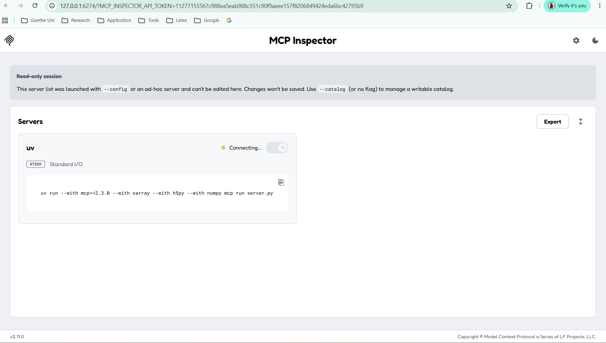
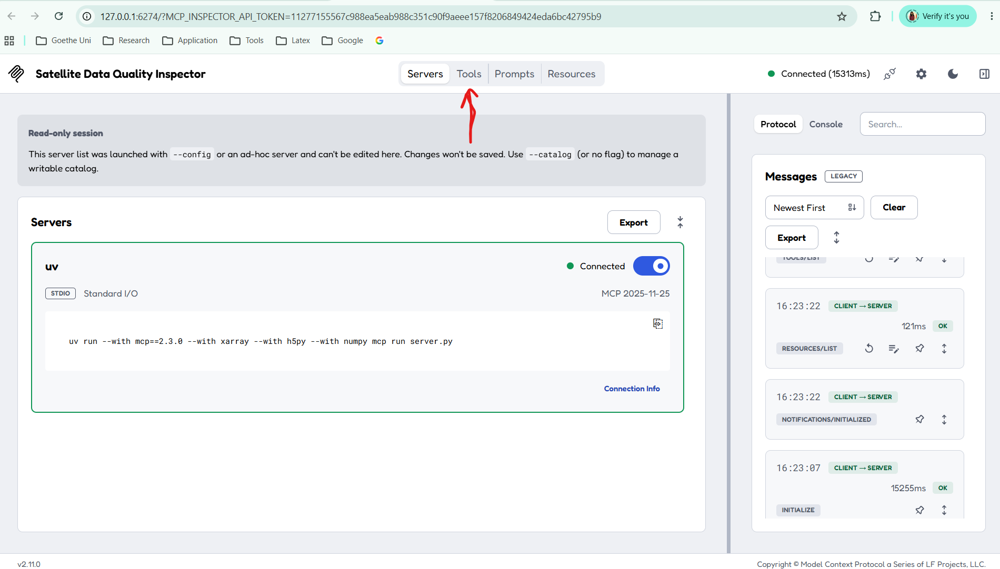
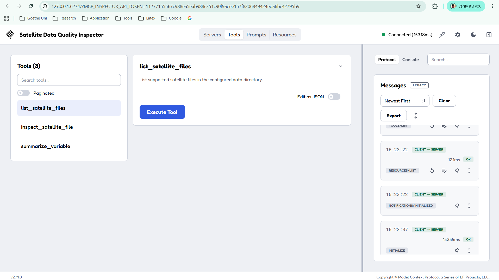
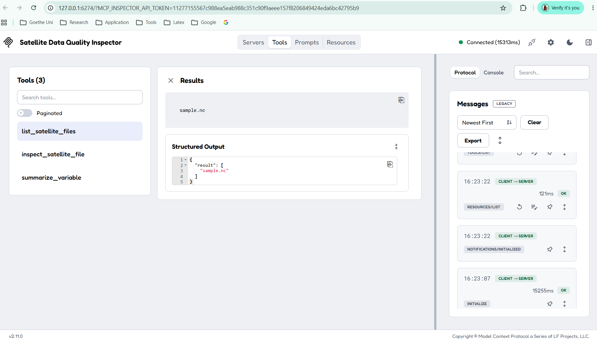
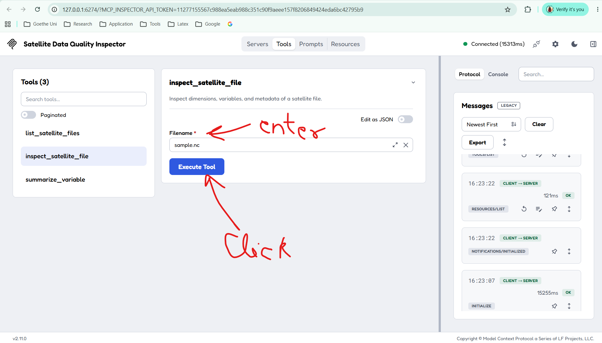
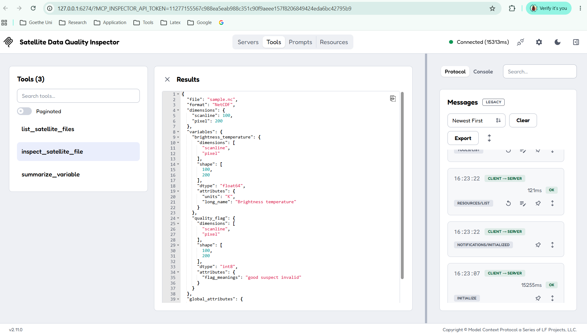
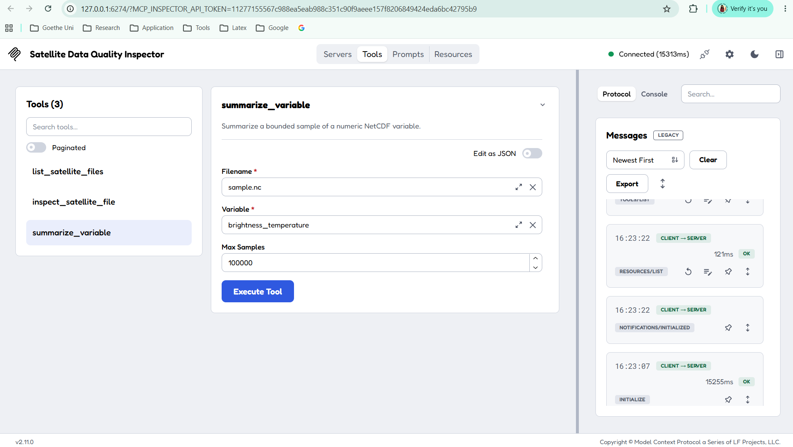
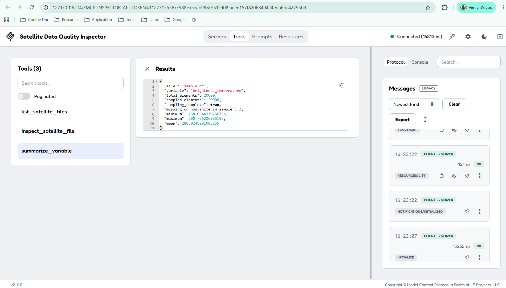

# Running and Testing the Satellite MCP Server with MCP Inspector

This guide documents the **hands-on workflow** for starting the MCP development server, opening MCP Inspector, connecting to the Python server, and testing each tool. It uses the steps recorded on 14 October 2026 and the screenshots embedded in the Windows Steps Recorder file.

> **Scope:** This is a run-and-test guide. 

## 1. What you are starting

In terminal run following command:

```
uv run mcp dev server.py --with h5py --with numpy --with xarray
```

In this workflow:

- **`uv run`** runs a command in the Python environment managed by `uv`.
- **`mcp dev server.py`** starts the MCP development workflow and launches MCP Inspector.
- **`server.py`** is the Python MCP server. It defines the tools available to the Inspector.
- **`--with h5py --with numpy --with xarray`** asks `uv` to make these Python packages available for this run. If the server also imports other packages, such as `netCDF4`, or if prefer a reproducible project environment, make sure those dependencies are installed or declared in the project as well.
- **MCP Inspector** is a testing client. It lets us to connect to the server, discover tools, enter arguments, execute them, and view results. It is not the AI model and it does not replace Python functions.

The key relationship is:

**Browser / MCP Inspector → MCP connection → `server.py` → Python function → satellite file → result returned to Inspector**

## 2. Start the server from the correct project directory

### Step 1 — Open the project in the terminal

Go inside the project in terminal. 

### Step 2 — Run the development command

Run:

`uv run mcp dev server.py --with h5py --with numpy --with xarray`

Wait for the terminal to print the Inspector address. 

- `Starting MCP inspector...`
- `MCP Inspector Web is up and running at:`
- a local URL beginning with `http://127.0.0.1:6274`
- `Opening browser...`

Leave this terminal running while you use Inspector. It is hosting the development process and displaying server errors or diagnostic messages.



> **Security note:** the URL printed by Inspector may include an `MCP_INSPECTOR_API_TOKEN`. Treat the complete URL and token like a temporary secret. Do not post it publicly or include it in documentation. If you share screenshots, crop or redact the token.

### Step 3 — Connect to the server

Your recorded action was to click the switch labelled **“Connect or disconnect 'uv'”**. Click that switch to connect. Wait for the interface to show a connected state and for the server's capabilities to load.



**What this means:** Inspector is acting as an MCP client. It establishes a connection to the development server and asks what capabilities are available. The server advertises the tools that have been registered in `server.py`.

If connection fails:

1. Check that the terminal running `mcp dev` is still open.
2. Read any error printed in that terminal.
3. Confirm that `server.py` imports successfully and that the dependencies it imports are available.
4. Use the current Inspector URL printed by the terminal.
5. If Node.js or `npx` errors appear, check the Node/npm installation used by the environment running the MCP development command.

## 4. Open the Tools section

After connecting, select the **Tools** area in Inspector. You should see the tools registered by the Python server.



The recorded session shows these three tool names:

1. `list_satellite_files`
2. `inspect_satellite_file`
3. `summarize_variable`



Your exact list depends on the version of `server.py` that is currently running. If one of these names is absent, do not assume Inspector is broken: confirm that the corresponding function is present and registered as a tool in the server code, then restart the development command.

**Important:** opening the **Resources** or **Prompts** sections does not mean you have implemented resources or prompts. Those are separate MCP capabilities. This walkthrough tests the three tools above.

## 5. Test Tool 1 — `list_satellite_files`

### Step 4 — Select the tool

Click `list_satellite_files` in the tools list. In the recording, this was followed by clicking **Execute Tool**.

This tool is expected to list supported files that the server allows it to see in the configured data directory.

### Step 5 — Execute the tool

Click **Execute Tool**. If the sample dataset is in the expected data directory and the function is implemented as described, a result similar to the following is expected:

`["sample.nc"]`

The exact output depends on which supported files are in the directory. If there are several files, you may see more than one filename.



**What happened behind the scenes:**

1. Inspector sent a tool-call request to the MCP server.
2. The server dispatched the request to the Python function registered as `list_satellite_files`.
3. The function inspected the configured data directory.
4. The server returned the function's result to Inspector.

If the result is empty, check the data directory and the configured `SATELLITE_DATA_DIR` value (if you use one). If an error appears, read the error text and the terminal output.

## 6. Test Tool 2 — `inspect_satellite_file`

### Step 6 — Select the tool

Click `inspect_satellite_file`.

The tool should show a field named `filename`. In the recorded session, you clicked that field and pasted the sample filename.

### Step 7 — Enter the filename

Enter:

`sample.nc`

Use the filename relative to the server's permitted data directory if that is how `safe_file()` is implemented. Do not enter an arbitrary absolute path unless the tool explicitly documents support for it.






### Step 8 — Execute the tool

Click **Execute Tool** and inspect the returned metadata.

For the synthetic sample described in the project explanation, look for:

- dimensions named `scanline` and `pixel`;
- `scanline` with length `100`;
- `pixel` with length `200`;
- variables such as `brightness_temperature` and `quality_flag`;
- variable attributes such as units and flag meanings, if implemented by the tool.



**Why this test is useful:** it checks that the server can locate and open a scientific data file, read its structure, and return useful metadata without requiring you to calculate statistics yet.

If the file is not found, verify that `data/sample.nc` exists and that you started the command from the expected project directory. If the dimensions or variables differ, verify that the sample file is the one you intended to test.

## 7. Test Tool 3 — `summarize_variable`

This tool calculates basic statistics for a selected variable. Your recording shows the tool being selected, its arguments being filled in, and **Execute Tool** being clicked.

### Step 9 — Select the tool

Click `summarize_variable`.

The Inspector form should contain fields for the filename and variable, and may also show `max_samples`, depending on the tool schema in your current `server.py`.

### Step 10 — Enter the filename

Enter:

`sample.nc`

### Step 11 — Enter the variable name

Enter:

`brightness_temperature`

This must match the variable name in the NetCDF file exactly.



### Step 12 — Set the sample limit if the field is shown

If your tool exposes `max_samples`, use:

`100000`

The sample dataset has 100 × 200 = 20,000 brightness-temperature elements, so this limit is large enough to include every element in that small test file.

For a real satellite product, a sample limit can prevent a test call from loading or processing an unnecessarily large amount of data. Whether it samples, truncates, or processes in chunks depends on how the Python tool is implemented.

### Step 13 — Execute and inspect the result

Click **Execute Tool**. Read the output panel for the statistics returned by your implementation.

For the synthetic dataset described in the project explanation, the expected checks are:

- total elements: `20000`;
- sampled elements: `20000`, if the implementation reports this field and the sample limit is 100000;
- missing or non-finite elements: `2`, because the sample creation step deliberately inserted two `NaN` values.

The minimum, maximum, and mean depend on the actual generated values and on the exact implementation. Do not treat them as fixed constants unless you use a fixed seed and the same sample file.

**Scientific caution:** this is a basic numerical summary, not a complete satellite product validation. Real products can use fill values, scaling metadata, valid ranges, and product-specific quality flags. The tool must account for those conventions before its statistics can be trusted.

## 8. What the complete test proved

If all three tools return sensible results, you have tested the following path:

1. The development command starts Inspector and the Python server.
2. Inspector connects as an MCP client.
3. Inspector discovers the tools advertised by the server.
4. You choose a tool and provide its arguments.
5. The MCP server routes the request to the matching Python function.
6. The function accesses the sample file and performs its work.
7. The server returns a result, and Inspector displays it.

You did **not** need to implement JSON-RPC, tool discovery, or the Inspector interface yourself. The MCP SDK and Inspector handle that protocol and testing infrastructure. Your code focuses on the scientific file operations and calculations.

## 9. Troubleshooting checklist

| Symptom | What to check |
|---|---|
| Inspector page does not open | Copy the current URL from the terminal; confirm Inspector is still running. |
| Inspector opens but is not connected | Click the connection switch; check terminal errors and the current URL/token. |
| No tools appear | Confirm `server.py` imports and registers tools; restart the development command after code changes. |
| `sample.nc` is not found | Confirm the file exists in the configured data directory and the command was launched from the project folder. |
| `ModuleNotFoundError` | Install or declare the missing package in the environment used by `uv`; restart the server. |
| Tool returns an argument/schema error | Check the displayed input fields and provide the exact field names and data types expected by the tool. |
| Statistics do not show two missing values | Confirm you are inspecting `brightness_temperature`, using the intended `sample.nc`, and that missing/non-finite values are counted by the function. |
| Keychain/secret-store warning | Inspector fell back to file storage; this is distinct from a Python server exception. Review secret-storage security before using sensitive credentials. |

## 10. Stop the session safely

When you finish testing, return to the terminal where the command is running and press **Ctrl+C**. This stops the development process. Close the Inspector browser tab if you no longer need it.

If you plan to share your screenshots or this guide, first check that they do not expose API tokens, credentials, private file paths, or other information you do not want to disclose.

## Screenshot note

The images in this guide were extracted from the attached Windows Steps Recorder `.mht` recording and stored in the `images/` subfolder. Windows Steps Recorder captured screenshots for steps 13–37; earlier recorded actions did not have screenshots. A screenshot shows the state of the interface at that moment, but the written instructions above explain the intended action and why it matters.
